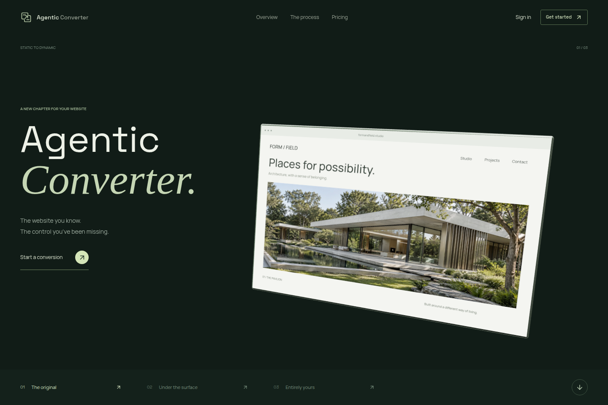

<p align="center">
  
</p>

<h1 align="center">Agentic Converter</h1>

<p align="center">Static websites. Dynamic content. Your own admin workspace.</p>

<p align="center">
  <a href="LICENSE"></a>
  
  
  
</p>

<p align="center">
  <a href="#quick-start">Quick Start</a> &nbsp; / &nbsp;
  <a href="#architecture">Architecture</a> &nbsp; / &nbsp;
  <a href="docs/handover.md">Professor Handover</a> &nbsp; / &nbsp;
  <a href="#testing">Testing</a>
</p>

Agentic Converter is Muhammad Hamad's final-year project: a source-preserving,
agent-assisted workflow that turns a static website URL or ZIP archive into a
database-backed application with editable pages, media, collections, and a generated
admin panel. The original HTML, CSS, scripts, fonts, and assets are retained where captured.



## What It Does

| Stage | Result |
| --- | --- |
| Capture | Static-source classification, URL crawling or safe ZIP ingestion, pages and assets |
| Infer And Review | Agent-assisted content schema with explicit user approval |
| Generate | Source-preserving public website, database, APIs, and responsive admin |
| Validate | Build, runtime, source-completeness, and quality reports |
| Preview And Export | Navigable local preview and downloadable application source |

The platform includes profile photos, conversion history, live account statistics,
role-aware dashboards, Stripe checkout, and emailed password recovery.

| Account | Access |
| --- | --- |
| Starter | 5 conversions total |
| Pro | Unlimited conversions, $199 USD one-time |
| Administrator | Unlimited access and platform administration |

## Architecture

```text
Browser / React + Vite + Three.js
                    |
          Express / TypeScript API
            |                 |
       PostgreSQL          Redis / BullMQ
                              |
                 FastAPI / LangGraph worker
                              |
            Capture -> Infer -> Approve -> Generate
                              |
                     Validate -> Export
                              |
             Generated React + Express + Prisma app
                 SQLite content database + admin
```

| Directory | Responsibility |
| --- | --- |
| `apps/frontend` | React 18, TypeScript, Vite, Three.js, GSAP, Zustand, and React Router |
| `apps/backend` | Express API, Prisma/PostgreSQL, JWT/Argon2 auth, queues, billing, preview gateway |
| `apps/worker` | Python/FastAPI, LangGraph, capture, LLM inference, generation, validation, export |
| `scripts` | Private environment preparation and local payment/email setup |
| `docs` | Handover guide and implementation notes |
| `infra` | Optional cloud/infrastructure templates, not the local demo deployment |

## Quick Start

Use Docker Compose for the supported demonstration setup. Node.js 22+ is required
on the host for the setup helpers. Docker must be running; allow disk space for
the worker's Chromium and generated-app dependencies. Conversion requires internet
access and a configured LLM provider.

```bash
git clone https://github.com/muhammadhamad1104/Agentic-Website-Converter.git
cd Agentic-Website-Converter
node scripts/prepare-env.mjs
```

The helper creates the root `.env` from `.env.example`, generates private JWT and
backend-to-worker secrets, preserves existing provider credentials, and sets private
file permissions. Add your provider credentials to this file. Never commit it.

For a **first installation**, initialize the database before starting the API:

```bash
docker compose build backend frontend worker
docker compose up -d --wait db redis
docker compose run --rm --no-deps --pull never backend npm run migrate
docker compose up -d --no-build
```

`npm run migrate` synchronizes the Prisma schema with `prisma db push`. It does not
use a production migration-history workflow and never passes `--accept-data-loss`.
Back up an existing database before schema changes.

| Service | Local Address |
| --- | --- |
| Application | [localhost:5173](http://localhost:5173) |
| API health | [localhost:5000/api/health](http://localhost:5000/api/health) |
| Worker API documentation | [localhost:8000/docs](http://localhost:8000/docs) |
| Generated preview gateway | `localhost:5001`, accessed through the project preview |

Register a Starter account through the application. To create a separate platform
administrator, set `SEED_ADMIN_EMAIL`, `SEED_ADMIN_PASSWORD` (at least 12 characters),
and optionally `SEED_ADMIN_NAME` in `.env`, then run:

```bash
docker compose run --rm --no-deps --pull never backend npm run seed
```

Seeding does not reset existing passwords or elevate an existing non-admin account.
This is the **platform admin**, separate from each converted application's `/admin`.

### Updating And Restarting

Published images and student-domain/hosting options are documented in the
[containers and hosting guide](docs/hosting.md).

On an already configured machine, open Docker Desktop, select **Containers**, and
press **Start** on the complete **agentic-converter** group. Open
[localhost:5173](http://localhost:5173) once the services are healthy. No terminal
commands, database setup, or payment/email helper are needed for ordinary restarts.
Start the whole group, not only the frontend; the existing Stripe listener is needed
for local test-payment webhooks. The app still needs internet for LLM calls and SMTP.

Containers use `unless-stopped`: running containers return when Docker starts, but
containers you explicitly stop stay stopped until you press Start again. You can
enable **Settings > General > Start Docker Desktop when you sign in** separately.
Do not delete the containers or data volumes if you want to retain this one-click setup.
Starting existing containers does not pick up code or `.env` edits; use the update
commands below after making changes. Health checks show readiness, not conversion quality.

```bash
docker compose up -d --build backend frontend worker
docker compose ps
```

Changed Docker layers are rebuilt; unchanged layers remain cached. The frontend
serves the compiled image, not a misleading source bind mount. An environment-only
backend change requires recreation, not a simple restart:

```bash
docker compose up -d --no-deps --no-build --force-recreate backend
```

If `PREVIEW_API_SECRET` changes, recreate backend and worker together. If a `VITE_*`
setting changes, rebuild the frontend because those values are embedded at build time.
If Docker Desktop's build resolver reports `EAI_AGAIN`, use the optional project-scoped
builder instead of changing global Docker settings:

```bash
node scripts/build-project.mjs
docker compose up -d --no-build
```

Its build DNS is configured in `scripts/buildkitd.toml`; adapt it for networks requiring
private resolvers. Runtime container DNS uses `APP_DNS_PRIMARY`/`APP_DNS_SECONDARY` instead.
Stop everything, including the optional test services, with:

```bash
docker compose --profile demo down
```

Do not add `-v`: that deletes the PostgreSQL and Redis volumes. Worker jobs, ZIP
uploads, and generated output persist in the worker's local data directories.

## Configuration And Secrets

Docker Compose uses the **root `.env`**. Optional service-local `.env` files are for
manual development and are also ignored. `.env.example` files contain templates only.

| Configuration | Variables |
| --- | --- |
| Private application secrets | `JWT_SECRET`, `PREVIEW_API_SECRET` |
| LLM providers | `OPENAI_API_KEY`, `KIMI_API_KEY`, `DEEPSEEK_API_KEY`, `GEMINI_API_KEY`, `GROQ_API_KEY`, optional alternatives |
| Payments | `STRIPE_SECRET_KEY`, `STRIPE_WEBHOOK_SECRET`, `VITE_STRIPE_PUBLISHABLE_KEY` |
| Recovery email | `SMTP_HOST`, `SMTP_PORT`, `SMTP_USER`, `SMTP_PASS`, `SMTP_FROM`, `FRONTEND_URL` |
| Platform admin setup | `SEED_ADMIN_EMAIL`, `SEED_ADMIN_PASSWORD`, `SEED_ADMIN_NAME` |

Secrets are passed to containers as runtime environment variables. Docker administrators
can inspect those variables; `.env` is not an encrypted vault. The Stripe **publishable**
key is intentionally public in the browser. No secret API key should ever use a `VITE_`
prefix. Generated applications have their own private backend `.env`.

Git and Docker build exclusions cover environment variants and private key files.
Ignoring a file does not erase an older commit: rotate previously exposed credentials.
See [the security notes](SECURITY.md) before publishing or sharing a handover archive.

## Payments And Recovery Email

Configure matching Stripe **test** keys in `.env`, then run:

```bash
node scripts/setup-local-services.mjs
```

This starts the optional `demo` profile's Stripe CLI listener, privately stores its
webhook secret, and recreates the backend. It refuses live keys, production environments,
and replacement of a different existing webhook secret. Keep the listener running for
automatic Pro activation during the demonstration.

Use Stripe's `4242 4242 4242 4242` test card, a future expiry, and any three-digit CVC.
Test-mode checkout does not charge real money. The signed webhook, not the browser,
grants Pro access.

For email, choose either:

- **Mailtrap Sandbox:** `SMTP_HOST=sandbox.smtp.mailtrap.io`, port `2525`,
  `SMTP_SECURE=false`, the sandbox's SMTP username/password, and a plain sender email.
  Set `SMTP_ALLOW_INSECURE_LOCAL=false`. Read messages in your Mailtrap sandbox.
- **Local Mailpit:** Leave SMTP blank and run the setup helper. It configures a
  development-only inbox at [localhost:8025](http://localhost:8025).

Both are testing inboxes, **not real Gmail delivery**. Existing external SMTP settings
are preserved by the helper. `MAILTRAP_API_TOKEN` is optional account-management/testing
tooling, not the sandbox SMTP password. Reset links expire after 15 minutes, are single-use,
and revoke old sign-in sessions after a successful reset. Password changes trigger a
security notification. Signup email verification is not implemented.

## Generated Applications

Open a completed project and select **Preview**. The preview address bar supports paths,
queries, and `/admin`; admin links are not injected into the public website. Leaving the
project screen releases its preview lease, and idle runtimes are stopped.

Download and extract the application, then follow its own README and export report.
Generated local setup creates `backend/.env`; local-only demo admin credentials are
`admin@gmail.com` / `admin123`. Change `ADMIN_EMAIL` and `ADMIN_PASSWORD`, then restart
the generated backend. Defaults are rejected in production mode or on a non-loopback
bind address. Do not expose them through a proxy or tunnel.

Export is best-effort when generated files exist. A downloadable ZIP may still contain
capture/build warnings; `export-report.json` and runtime validation determine readiness.
Full-site capture has no application page cap, but source availability, provider quotas,
context windows, storage, and network failures still apply. Perfect fidelity is not guaranteed.

## Testing

```bash
# Frontend components and workflows
npm --prefix apps/frontend test

# Backend API, plans, recovery, uploads, and preview isolation
npm --prefix apps/backend test -- --runInBand

# Setup helpers (Node.js 22+)
node --test --test-isolation=none scripts/prepare-env.test.mjs scripts/setup-local-services.test.mjs

# Worker suite, using an installed Python environment
cd apps/worker
python -m pytest -q
```

Install the respective service dependencies before running tests outside Docker.
The worker's opt-in generated application test builds a real app, exercises its admin,
and checks persistence and browser behavior:

```bash
cd apps/worker
RUN_RUNTIME_INTEGRATION=1 python -m pytest tests/test_generated_runtime_integration.py -q
```

See [worker diagnostics](apps/worker/README.md) for source comparisons and real
provider-backed conversion acceptance runs. These can consume provider credits.

## Handover And Deployment

The [professor handover guide](docs/handover.md) includes the demo sequence, recovery
checks, restart commands, expected limitations, and a deployment checklist.
The supported local demo is not a claim of production certification.

Before public deployment: configure HTTPS and a dedicated preview origin, real Stripe
webhooks, a verified email sender, private database access, backups, unique credentials,
and monitoring. Review infrastructure templates before applying them.
`scripts/deploy.sh` provisions AWS resources and can incur charges; it is not a demo step.

## License

Original project code is released under the [MIT License](LICENSE).
Copyright (c) 2026 Muhammad Hamad.

Third-party dependencies, sample images, and captured website content retain their own
licenses and ownership. Convert only content you have permission to use.
